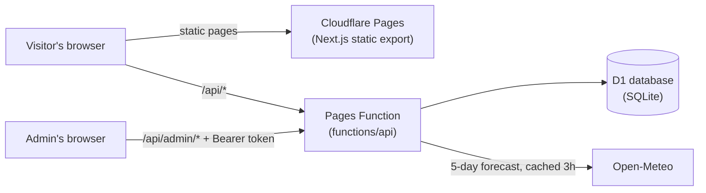

# Real Weekend

**A Glassdoor / AmbitionBox for tourist places.** Travellers read short, honest, recent ratings, photos and local updates for a weekend destination *before* they plan or book. No login, no AI at runtime, free to run.

> Built by Rakesh for the goSTOPS Build Sprint. Not an official goSTOPS product.

**Live demo:** https://real-weekend.pages.dev

---

## Table of contents

1. [Why this exists](#why-this-exists)
2. [Features](#features)
3. [Architecture](#architecture)
4. [Tech stack](#tech-stack)
5. [Project structure](#project-structure)
6. [Data model](#data-model)
7. [API reference](#api-reference)
8. [Rules built into the product](#rules-built-into-the-product)
9. [Getting started (local)](#getting-started-local)
10. [Deploying to Cloudflare](#deploying-to-cloudflare)
11. [Using the admin](#using-the-admin)
12. [Limits and known gaps](#limits-and-known-gaps)
13. [Roadmap](#roadmap)

---

## Why this exists

People who are still deciding where to go for a short weekend trip jump between city pages, blog posts, maps and review sites. By the time they book, the research is already done somewhere else.

Real Weekend puts that research in one place:

- **Who it is for:** Gen Z travellers, often solo, on Friday-night-to-Sunday-night trips.
- **What it answers:** "Is this place worth my limited time, and what should I skip?"
- **What makes it different:** reviews are about *places*, not hotels, and every photo shows when it was actually taken.

## Features

### For visitors

**Home (directory)**
- Search box. No questions are asked before results appear.
- Filters: who is going (Solo, Couple, Friends, Family), vibe, type, region, weekend spend, "good this month".
- Sorting: top rated, most reviewed, recently updated, lowest spend.
- Curated rows: *Top rated*, *Best for solo*, *Best on a budget*, *Newly updated*.
- Place cards with a cover photo (or generated art), rating, one top tag, spend range and a season chip.

**Place page**
- Banner, rating summary (great / okay / bad bars), tag percentages (worth it, crowded, pricey, hidden gem, unsafe at night) and a "who rated" breakdown by group.
- **"Who is it for?"** group filter that re-ranks spots and reviews.
- **"Where to spend your time":** spots ranked by rating. The lowest-rated are greyed as *skip if you're short on time*. A *How long do you have?* chip (half day, full day, 2 days) fits the best spots into the time available.
- **Plan B for rain or crowds:** indoor spots.
- **Reviews** with group, face rating, comment, a *Helpful* button, sorting and *Load more*.
- **Recent photos**, newest first, labelled *Taken 3 days ago* (date read from the photo) or *Unverified date*, with a *Report* button and a lightbox.
- **Things to know** (admin-written): 5-day weather forecast, latest updates, services (plain text, no links) and coming up.
- Share button, *Rate this place* button, and a quiet link to goSTOPS stays.

**Rating flow** (`/rate?p=<place>`): the link a property would send after checkout
- One question per screen, about two minutes: who you went with, a face (bad / okay / great) per spot with an optional tag, up to 3 photos, an optional 140-character comment.
- Photos are shrunk in the browser and location data is stripped.

### For the admin (`/admin`, password only)

- **Services:** add and delete plain-text services (bike taxi, scooter rental, cafes ...).
- **Updates:** short dated notes (closure, weather, road, transport, event, upcoming) that expire automatically.
- **Covers:** set each place's cover photo by upload or by pasting an image link.
- **New place:** add a new place from the admin, with no code change.
- **Spots:** edit times, priority, indoor flag and "suits" groups; add spots.
- **Reported photos:** hide or unhide photos that were reported. Ratings and opinions can never be deleted.
- **Stats:** visitors, searches, completed ratings and shares, plus visitors per day.

## Architecture



**Key decisions**

- **One static front end + one function.** Every page is a static file. All data goes through a single backend function, so there is one place to secure, test and rate-limit.
- **`src/lib/api.ts` is the only file that talks to the backend.** The UI never calls `fetch` anywhere else.
- **Everything lives in D1.** Ratings, photos (as small blobs) and covers are in the database. R2 would be the better home for photos at scale, but it needs a payment method, so it is not used.
- **No server-side AI.** Summaries are plain counts of taps, so there are no per-visit costs.
- **No visitor accounts.** A random device id (kept in the browser, hashed on the server) is used only for rate limiting, one "helpful" vote per review and one report per photo.

**Data flow, rating a place**

1. The rating page loads the property and its spots from `GET /api/property/:slug`.
2. The browser reads each photo's date taken (EXIF), shrinks the photo to about 1280 px, which also strips location data, and builds a `FormData` payload.
3. `POST /api/rate` validates the group, spots, scores, tags, photo size and rate limits, then writes the submission, ratings and photos in one batch.
4. Summaries are computed with SQL on read, so a new rating shows up on the next page load.

## Tech stack

| Area | Tools |
| --- | --- |
| Front end | Next.js 16 (App Router, static export), React, TypeScript |
| Styling | Hand-written CSS (design tokens, light and dark themes, responsive), designed with v0 |
| Backend | Cloudflare Pages Functions (a Worker) |
| Database | Cloudflare D1 (SQLite) |
| Weather | Open-Meteo (free forecast API), cached for 3 hours |
| Tooling | Wrangler CLI, npm |
| Tested with | Playwright (screenshots, overflow and flow checks) |

## Project structure

```text
.
├── app/
│   ├── layout.tsx            # root layout, metadata, viewport
│   ├── globals.css           # all styles (tokens, light/dark, responsive)
│   ├── page.tsx              # / directory (search, filters, rows, grid)
│   ├── place/page.tsx        # /place?s=<slug> place profile
│   ├── rate/page.tsx         # /rate?p=<slug> rating flow
│   ├── admin/page.tsx        # /admin backstage
│   └── stats/page.tsx        # /stats (opens the admin on the Stats tab)
├── src/
│   ├── components/
│   │   ├── ui.tsx            # header, footer, chips, stars, share, skeletons
│   │   ├── admin.tsx         # admin shell and tabs (services, updates, spots, reports, stats)
│   │   └── admin-extra.tsx   # admin Covers and New place tabs
│   ├── lib/
│   │   ├── api.ts            # the only file that calls the backend
│   │   ├── rank.ts           # overall vs per-group ranking rule
│   │   ├── photo.ts          # EXIF date reader + image compression
│   │   ├── format.ts         # rupees, "3 days ago", star conversion
│   │   └── mock.ts           # sample data for previews (off by default)
│   ├── types.ts              # shared TypeScript types
│   └── config.ts             # footer text, MIN_GROUP_RATINGS
├── functions/api/[[path]].ts # the whole backend
├── db/
│   ├── schema.sql            # tables and indexes
│   └── seed.sql              # the places and spots (generated, no reviews)
├── data/places.mjs           # source of truth for places and spots
├── scripts/gen-seed.mjs      # builds db/seed.sql (or sample reviews with `demo`)
├── public/_headers           # security headers
├── wrangler.toml             # D1 binding and Pages output directory
└── package.json
```

## Data model

| Table | Purpose |
| --- | --- |
| `destinations` | Places: name, state, region, type, emoji, vibes, best months, spend range, "suits" groups, lat/lon, goSTOPS page name |
| `spots` | Things to do at a place: travel and stay minutes, indoor flag, priority, "suits" groups |
| `properties` | Rating-link slugs mapped to a place (`/rate?p=<slug>`) |
| `submissions` | One row per person's review: group, comment, device hash, helpful count, sample flag |
| `ratings` | One row per rated spot: score 1 to 3, optional tag |
| `helpful` | One "helpful" vote per device per review |
| `photos` | Traveller photos: image bytes, date taken, verified flag, hidden flag, report count |
| `reports` | One report per device per photo |
| `covers` | Admin-set cover per place: uploaded bytes or an https link |
| `services` | Admin-written services per place |
| `updates` | Admin-written dated notes with an expiry |
| `events` | Anonymous counters: visit, search, filter, rating_done, share |

Scores are stored as 1 to 3 and shown as 1 to 5 stars (`stars = 1 + (avg - 1) * 2`).

## API reference

All routes are under `/api` and served by `functions/api/[[path]].ts`.

**Public**

| Method | Route | Description |
| --- | --- | --- |
| GET | `/destinations` | All places with rating summaries, last-updated time and cover |
| GET | `/destination/:slug` | Place profile: spots with summaries, reviews, photos, services, updates, forecast |
| GET | `/property/:slug` | Spots for the rating flow |
| GET | `/img/:key` | A traveller photo |
| GET | `/cover/:dest` | An admin-uploaded cover |
| POST | `/rate` | Submit a rating (`multipart/form-data`: `payload` JSON + `photos`) |
| POST | `/helpful` | Mark a review helpful |
| POST | `/report` | Report a photo (hidden automatically after 3 reports) |
| POST | `/event` | Anonymous usage counter |

**Admin** (all need `Authorization: Bearer <token>` except login)

| Method | Route | Description |
| --- | --- | --- |
| POST | `/admin/login` | Exchange the password for a 12-hour signed token |
| GET | `/admin/data?dest=` | Services, updates and spots for a place |
| GET | `/admin/reports` | Reported or hidden photos |
| GET | `/admin/stats` | Visitor, search, rating and share counts |
| POST | `/admin/service`, `/admin/service/delete` | Add, edit or delete a service |
| POST | `/admin/update`, `/admin/update/delete` | Add, edit or delete an update |
| POST | `/admin/spot` | Add or edit a spot |
| POST | `/admin/photo` | Hide or unhide a photo |
| POST | `/admin/cover` | Set (upload or link) or clear a cover |
| POST | `/admin/destination` | Add a new place |

## Rules built into the product

- **Reviews are about places, never about the stay.** A rating asks who you went with, then a face per spot.
- **Group rankings need evidence.** A group ranking (for example "Solo") only counts once a place or spot has **5 ratings from that group** (`MIN_GROUP_RATINGS` in `src/config.ts`). Until then it falls back to the overall rating and says *Not enough solo ratings yet*. The admin's "suits" labels appear as *Our pick*.
- **No invented data.** A place with no ratings says *Not yet rated by travellers*. Sample data exists only in local test databases and is flagged.
- **Nobody deletes opinions.** The admin can only hide photos that were reported (spam, abuse, personal information, off topic).
- **Fresh photos.** Photos are sorted by the date they were taken. Photos with no readable date are labelled *Unverified date*.
- **Anti-abuse:** a hidden honeypot field, 5 submissions per hour per device, 3 photos per place per device, photos capped at 1 MB, auto-hide after 3 reports.
- **Services are plain text.** No links, so nothing opens a booking.
- **Spend ranges are rough.** They are labelled *rough* in the interface.

## Getting started (local)

You do not need a Cloudflare account to run it on your computer. The database and photos are stored in `.wrangler/` inside the project folder.

```bash
# 1. install
npm install

# 2. create the local database and load the places
npx wrangler d1 execute real-weekend --local --file db/schema.sql
npx wrangler d1 execute real-weekend --local --file db/seed.sql

# 3. optional: sample reviews so the pages are not empty (local only, never in production)
node scripts/gen-seed.mjs demo
npx wrangler d1 execute real-weekend --local --file db/demo.sql
```

Create a file named `.dev.vars` in the project root (it must never be committed):

```text
ADMIN_PASSWORD=choose-a-password
TOKEN_SECRET=a-long-random-text
```

Run it:

```bash
npm run local
```

Open http://localhost:8788. The admin is at `/admin`.

> `npm run local` builds the site and runs the front end and the backend together. `npm run dev` runs only the front end; for it to reach the backend, run the Wrangler command from `npm run local` in a second window and open http://localhost:3000.

Make sure `.dev.vars` and `.wrangler/` are in `.gitignore`.

## Deploying to Cloudflare

The free plan is enough for a demo. Check Cloudflare's pricing page for current limits before launch.

```bash
npx wrangler login

# create the database, then paste its id into wrangler.toml (database_id)
npx wrangler d1 create real-weekend

# load the tables and places into the online database
npx wrangler d1 execute real-weekend --remote --file db/schema.sql
npx wrangler d1 execute real-weekend --remote --file db/seed.sql

# build and deploy
npm run build
npx wrangler pages deploy out --project-name real-weekend --branch production

# set the two secrets (you are prompted for each value)
npx wrangler pages secret put ADMIN_PASSWORD --project-name real-weekend
npx wrangler pages secret put TOKEN_SECRET --project-name real-weekend

# deploy once more so the secrets take effect
npx wrangler pages deploy out --project-name real-weekend --branch production
```

Notes:

- Use a long random value for `TOKEN_SECRET` and a different value from your local one.
- Do **not** run `db/demo.sql` on the live database. Do not re-run `db/seed.sql` on a live database that already has data.
- Before building, set your name in `src/config.ts`. The footer line is part of the build.
- Never set `NEXT_PUBLIC_USE_MOCK=true` in production, or the site will show sample data instead of the backend.

## Using the admin

1. Open `/admin` and log in with `ADMIN_PASSWORD`. The login lasts 12 hours. There are no usernames; anyone with the password has full admin access.
2. **Covers:** give each place a photo (upload a file you own, or paste an `https://` image link).
3. **Services** and **Updates:** fill in what is available now and what is happening. Updates need an expiry date.
4. **Spots:** check times, priority and "suits" labels.
5. **New place:** add places beyond the starting 12, then add their spots and a cover. A rating link `/rate?p=<name>` is created automatically.
6. **Reported photos:** review anything that visitors reported.
7. **Stats:** see visitors, searches, ratings and shares.

## Limits and known gaps

- **Content is estimated.** The 12 places, their spots and spend ranges were assembled for this demo. Confirm them against real data before relying on them.
- **No reviews at launch.** Real ratings only come from visitors.
- **Photos live in the database.** Fine for a demo of tens of photos. For real traffic, move them to object storage.
- **Free-plan limits apply.** Cloudflare's free tier caps backend requests per day and database size. Photos are served through the backend, so many photo views count against the request limit.
- **Weather** comes from Open-Meteo. Check their terms if this is used commercially.
- **One shared admin password,** no per-person accounts, no audit trail.
- **No per-booking rating links.** Anyone with a place's rating link can rate it. The "thank-you after checkout" message has to be sent by the property's own systems.
- **The admin cannot yet edit or delete an existing place,** only add new ones.
- **Share previews** are generic. Per-place previews are not possible on a fully static site.

## Roadmap

- User accounts and replies between users, so reviews become conversations.
- One-time rating links tied to a booking, with a "verified stay" badge.
- Editing and deleting places in the admin.
- Cloudflare Turnstile bot protection.
- Move photos to R2 or another object store.
- Partner stays, events and collaborations shown next to a place.
- Share image cards for Instagram stories.

## Credits and licence

Built by Rakesh for the goSTOPS Build Sprint. This is an independent demo and **not an official goSTOPS product**. Add a licence file before publishing the code publicly.
